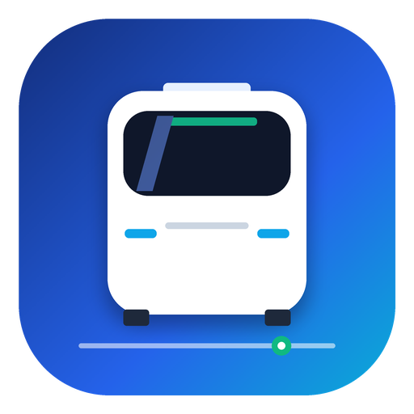

<p align="center">
  
</p>

# CleanBus (纯净公交)

<p align="center">
  <strong>超轻量 · 零臃肿 · 全国三四五线覆盖 · 双源自愈 · 100% 原生 Android 实时公交客户端</strong>
</p>

<p align="center">
  
  
  
  
</p>

---

## 💡 项目初衷

市面上的实时公交 App（如车来了、掌上公交等）普遍存在体积数十上百 MB、开屏摇一摇广告泛滥、过度索取权限、启动卡顿发热等问题，且主流应用常忽视三四五线城市、边疆地州与下沉县级市的实时公交数据支持。

**CleanBus** 坚持极客原则，彻底重构实时公交查询体验：
1. **极致轻量**：安装包仅数十 KB（< 100 KB），全工程 **零第三方 SDK**、零 Jetpack 依赖、零冗余库，100% 纯原生 Android Framework Views。
2. **全国双源互补**：深度整合「车来了」与「掌上公交（MyGoLBS）」底层直连协议，覆盖一二线城市并强力打通西藏拉萨、贵州兴义/遵义/六盘水、四川宜宾等下沉市场。
3. **极速国内直连 + 规则热更**：日常查车默认直连国内 CDN（80ms 秒开）；掌上公交的接口地址与密钥由 Cloudflare Workers 每 30 分钟自动嗅探并验活，车来了的密钥通过受签名保护的管理通道人工下发——两者都**无需发版**，但只有掌上公交是全自动的。断供时 Worker 自动建 issue 告警。详见 [docs/ops.md](docs/ops.md)。
4. **纯粹隐私保护**：无开屏广告、无弹窗、无后台常驻、不追踪任何用户隐私与设备 ID。

---

## 🚀 核心架构与技术亮点

### 1. 纯原生 Java + 精准字节码控制
- 放弃引入重量级依赖库，全套 UI 采用纯原生 Java + 原生 XML 布局手写构建。
- 采用独立 R8 字节码优化剪裁 + AAPT2 极简打包管道，产物仅包含单个极简 `classes.dex`。

### 2. 双数据源动态调度架构
```
                [用户查车请求]
                      │
                      ▼
              ┌────────────────┐
              │ BusRepository  │ 智能多级调度
              └───────┬────────┘
                      │
        ┌─────────────┴─────────────┐
        ▼                           ▼
┌───────────────┐           ┌───────────────┐
│ ChelaileSource│ (主干直连) │ MyGoLbsSource │ (下沉互补)
│ (AES-ECB加密)  │           │ (3DES对称加密) │
└───────┬───────┘           └───────┬───────┘
        └─────────────┬─────────────┘
                      │ (双源均受阻/格式异常)
                      ▼
              ┌────────────────┐
              │  CloudGateway  │ (CF Worker 兜底)
              └────────────────┘
```

- **ChelaileSource**：逆向车来了 Web/小程序 API，复刻 MD5 动态加签与 AES-256-ECB 解密。
- **MyGoLbsSource**：逆向掌上公交 H5 核心通讯层，复刻 3DES（`strDec`）解密算法及 CMD 字典（106周边/105经由/103静态/104实车/102搜索）。
- **CityLocator**：内置轻量级全国主要地市坐标离线盒（拉萨、北京、上海、成都、兴义、遵义等），断网秒定；同时支持 Android 原生 Geocoder 与 OSM 逆地理自动纠偏。

### 3. Cloudflare Worker 规则哨兵与免发版自愈 (`cloud_gateway/`)
- **自动嗅探**：定时（Cron `*/30 * * * *`）并发抓取上游 H5 宿主，动态模式匹配提炼最新的 `apiroot` 路由与加解密三元密钥。
- **动静分离冒烟断言**：提取后向静态站点表发送验活请求，断言成功后自动生成新版规则（`ruleVersion`）。
- **客户端 A/B 槽回滚机制**：客户端启动静默比对版本，通过候选槽试探生效；遇连续 3 次 400 自动熔断降级回退至内置稳定槽，保障 100% 高可用。

---

## 🛠️ 项目目录结构

```
clean_bus_app/
├── app/
│   └── src/main/
│       ├── java/com/geek/cleanbus/
│       │   ├── MainActivity.java        # 首页 (周边站台、常乘收藏、多城搜索)
│       │   ├── LineDetailActivity.java  # 线路详情 (站点轴线、实车动态、智能换向)
│       │   ├── BusRepository.java       # 双数据源聚合责任链
│       │   ├── ChelaileSource.java      # 车来了数据源实现
│       │   ├── MyGoLbsSource.java       # 掌上公交数据源实现
│       │   ├── CloudGatewaySource.java  # 云端容灾数据源
│       │   ├── DynamicRuleManager.java  # 动态配置与 A/B 槽试探
│       │   ├── CityLocator.java         # 离线全国城市逆地理推导
│       │   └── FavoritesManager.java    # 本地收藏管理器
│       └── res/                         # 原生矢量与视图资源
├── cloud_gateway/                       # Cloudflare Workers 自愈网关
│   ├── clean_bus_worker.js              # 云端网关全套源码
│   └── deploy_cf_worker.py              # 自动化部署部署工具
├── releases/                            # 预编译 APK 归档目录
├── tools/reverse_scripts/               # 逆向分析与协议测试脚本集合
├── build_clean_bus.ps1                  # 自动化独立打包构建脚本
└── version.json                         # 自动化版本控制配置
```

---

## 📦 编译与打包

本工程支持完全脱离臃肿的 Android Studio / Gradle，采用纯命令行极速编译（耗时仅约 3 秒）：

### 环境前置
- **OpenJDK 21**
- **Android SDK build-tools** (aapt2, r8, android.jar, uber-apk-signer)

### 执行编译
在 PowerShell 7 中运行：
```powershell
cd clean_bus_app
.\build_clean_bus.ps1
```
脚本将全自动自增版本号，并在 `releases/` 目录下产出经过 V1/V2/V3 完整签名的发布版 APK（如 `CleanBus_v1.0.13.apk` 及 `CleanBus_Release.apk`）。

---

## 📥 下载体验

预编译开箱即用 APK 可在 GitHub Releases 页面下载，直接在 Android 8.0+ (API 26+) 设备上安装运行。

---

## 📄 开源许可证

本项目基于 [MIT License](LICENSE) 开源。仅供技术学习交流与个人出行便捷使用。

